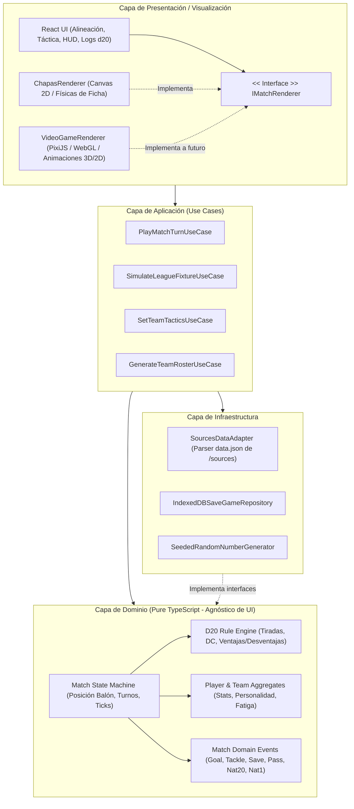
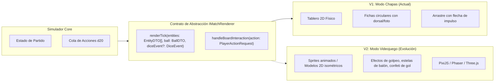
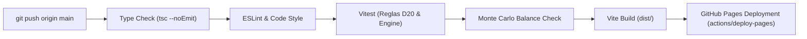

# Plan de Arquitectura e Implementación: D20 Soccer Manager - Fútbol 11 ("Modo Chapas" a "Videojuego")

## 1. Visión del Producto y Objetivos de Ingeniería

El objetivo es desarrollar un videojuego de gestión y simulación táctica de **Fútbol 11** basado en los clubes y equipos reales extraídos de `/Users/israelvinualeslopez/sources` (tanto la competición ECM Madrid como la Primera Futgal de Santa Cruz). Aunque las fuentes originales correspondan a categorías escolares (futsal y fútbol 8), **el motor de juego, la simulación, el tablero y las reglas se comportarán plenamente como Fútbol 11 profesional**.

El núcleo del sistema de juego se basa en **mecánicas de rol d20 (estilo D&D / Tabletop RPG)**:
- Cada equipo cuenta con una plantilla completa de **18 a 22 jugadores de Fútbol 11** (titulares 11 vs 11 y banquillo).
- Cada jugador es una entidad de rol con atributos numéricos (`FUE`, `DES`, `CON`, `INT`, `SAB`, `CAR`), rasgos de personalidad y modificadores de posición en campo grande.
- Cada acción clave (duelo aéreo de cabeza, cambio de juego a la banda contraria, centro al área, regate al lateral, disparo desde la frontal, mano a mano, intercepción del pivote) se resuelve mediante **tiradas de d20**, tiradas enfrentadas (*contested checks*), ventajas, desventajas, críticos (Nat 20) y pifias (Nat 1).
- La visualización inicial es un **tablero táctico "Modo Chapas" F11** (campo completo reglamentario con 22 fichas interactivas + balón), desacoplado limpiamente para evolucionar hacia un **"Videojuego" completo (Canvas 2D / WebGL / PixiJS / Phaser)** sin modificar las reglas de simulación.

> [!IMPORTANT]
> **Aislamiento absoluto del repositorio `sources`**:  
> El directorio `/Users/israelvinualeslopez/sources` opera exclusivamente como fuente de datos de solo lectura. El nuevo proyecto reside de forma autónoma en `/Users/israelvinualeslopez/projects/soccer`, con su propio repositorio Git, configuración de empaquetado, tests y ciclo de vida independiente.

---

## 2. Pila Tecnológica (Tech Stack) Justificada

| Capa | Tecnología | Justificación de Ingeniería |
| :--- | :--- | :--- |
| **Lenguaje Base** | **TypeScript 5.x (Strict Mode)** | Tipado estático exhaustivo. Vital para modelar el sistema de reglas d20, estados del motor y contratos desacoplados entre el simulador y los renderizadores. |
| **Tooling & Build** | **Vite** | Tiempos de arranque instantáneos en desarrollo, HMR ultrarrápido y empaquetado optimizado con Rollup para despliegue web estático (GitHub Pages / Netlify / Vercel). |
| **Frontend Framework** | **React 18/19** | Ecosistema maduro para la gestión de interfaces reactivas (pantallas de gestión táctica, alineaciones, selector de liga, historial de tiradas d20 en tiempo real). |
| **Estilos & UI Kit** | **Tailwind CSS + CSS Variables** | Permite recrear y refinar la identidad visual de la liga original (`--valle-blue: #004d99`, `--valle-yellow: #fdd835`, tarjetas de partidos, escudos). |
| **Gestión de Estado** | **Zustand** | Estado inmutable y desacoplado de React para la partida global (temporada, clasificación, configuración táctica). |
| **RNG & Determinismo** | **PRNG Seeded (Mulberry32 o PCG)** | Todo el sistema de dados d20 utiliza semillas deterministas. Esto permite: replicabilidad de bugs en tests, guardado de repeticiones (replays) ultraligeras y tests reproducibles. |
| **Física 2D & Tablero** | **Módulo Matemático Vectorial Propio (2D) + HTML5 Canvas** | Motor ligero de colisiones circulares (chapas), trayectorias balísticas y vectores de impulso. Cero dependencias pesadas innecesarias en la fase inicial. |
| **Persistencia Local** | **IndexedDB (vía `idb` / `dexie`)** | Almacenamiento local robusto de partidas guardadas, plantillas generadas y progreso de la liga sin depender de backend obligatorio. |
| **Testing Unitario & Lógica** | **Vitest** | Ejecución nativa ESM, integración perfecta con Vite, mocking ultrarrápido. |
| **Testing de Balanceo d20** | **Fast-Check (Property-Based) + Simulador Monte Carlo** | Pruebas estadísticas automáticas para verificar que la distribución de goles, tarjetas y éxitos d20 respeta la probabilidad matemática sin sesgos. |
| **Testing E2E** | **Playwright** | Automatización de flujos completos: selección de equipo, configuración de alineación y juego de un partido completo. |

---

## 3. Arquitectura de Software: Clean Architecture & Hexagonal

Para garantizar que el cambio futuro de interfaz (de "chapas" a "videojuego") no genere deuda técnica ni rompa las reglas de juego, se implementará una separación radical en capas:



### Principios Arquitectónicos Clave:
1. **Regla de Dependencia Unidireccional**: La capa de dominio (`Domain`) no sabe qué es React, ni Canvas, ni el DOM. Puede ejecutarse en Node.js, en un Web Worker o en el navegador.
2. **Event-Driven Match Stream**: El partido no renderiza directamente; emite eventos tipados (`BallPassed`, `TackleResolved`, `ShotFired`, `DiceCheckRolled`). El `IMatchRenderer` se suscribe a este stream y los anima.
3. **Pluggable Renderers**: La transición de "chapas" a "videojuego" consiste únicamente en escribir un nuevo adaptador `VideoGameRenderer` que implementa `IMatchRenderer`.

---

## 4. El Sistema de Rol D20 (The Soccer D20 Rulebook)

### 4.1. Atributos Base de los Jugadores (Fútbol 11)
Inspirados en la estructura clásica d20, adaptados a la biomecánica y amplitud espacial del Fútbol 11:

| Atributo | Significado en Fútbol 11 | Usos Principales en Tirada d20 |
| :--- | :--- | :--- |
| **FUE (Fuerza)** | Potencia de salto, choque, golpeo a distancia | Duelo aéreo de cabeza en córners/centros, despeje de central, tiro de larga distancia, pugna con el central. |
| **DES (Destreza)** | Velocidad punta, desborde en banda, reflejos | Regate en el 1vs1, repliegue del lateral, centros con comba, palomitas y reflejos del portero. |
| **CON (Constitución)** | Resistencia física en campo de 105m, fondo físico | Aguantar 90 minutos sin pérdida de modificadores, recuperación tras sprints reiterados de 40m. |
| **INT (Inteligencia)** | Visión periférica, juego asociativo, táctica | Cambios de orientación a banda contraria, pases filtrados entre líneas, timing de desmarques. |
| **SAB (Sabiduría)** | Lectura de juego, concentración defensiva | Tirar la línea del fuera de juego, intercepciones del pivote defensivo, temporizar al delantero rival. |
| **CAR (Carisma)** | Liderazgo, jerarquía, temple en momentos críticos | Capitán que otorga bonos a compañeros, templanza en tandas de penaltis o minutos de descuento. |

*Rango de atributos base*: 8 a 18 (con modificadores estándar d20 de -1 a +4).

### 4.2. Arquetipos y Personalidades (Traits)
- **"Especialista a Balón Parado"**: +3 en tiradas de lanzamiento de faltas directas y saques de esquina (`INT`/`DES`).
- **"Torre Aérea"**: Dispone de **Ventaja** en duelos de cabeza en área propia o contraria (`FUE`).
- **"Extremo Explosivo"**: Dispone de **Ventaja** en el primer sprint/regate por banda, pero gasta doble stamina.
- **"Mariscal Defensivo"**: Concede un bono pasivo de $+1$ a la `SAB` (colocación) de toda la línea de 4 defensores.
- **"Sangre Fría"**: Ignora las desventajas causadas por fatiga en los minutos 75 a 90.
- **"Cazagoles"**: En disparos dentro del área pequeña, cualquier tirada de 18 a 20 se resuelve como crítico (Nat 20).
- **"Pivote Destructor"**: +2 en entradas cuerpo a cuerpo (`FUE`), pero pifia (Nat 1-2) genera amonestación arbitral inmediata.

### 4.3. Resolución de Acciones Específicas de Fútbol 11
1. **Centro al Área y Duelo Aéreo (Tirada Compuesta)**:
   - Extremo/Lateral lanza centro: `d20 + Mod(DES)` vs DC según oposición en banda.
   - Si el centro es preciso $\rightarrow$ Duelo aéreo en el punto de penalti:
     - Delantero: `d20 + Mod(FUE) [Remate de cabeza]`
     - Central defensor: `d20 + Mod(FUE o SAB) [Despeje / Anticipación]`
     - Si el Delantero gana por 5 o más $\rightarrow$ Remate franco con **Ventaja** contra el portero.
2. **Pase Filtrado Rompiendo Líneas vs Fuera de Juego**:
   - Mediapunta: `d20 + Mod(INT)` [Pase filtrado]
   - Defensa rival: `d20 + Mod(SAB)` [Tirar el fuera de juego]
   - Si la defensa gana la tirada enfrentada $\rightarrow$ Posición antirreglamentaria (fuera de juego).
   - Si el pasador gana $\rightarrow$ El delantero queda en mano a mano frente al portero.
3. **Mano a Mano (Delantero vs Portero)**:
   - Delantero: `d20 + Mod(DES si define raso/vaselina, FUE si fusila)`
   - Portero: `d20 + Mod(DES si achica espacio, SAB si aguanta de pie)`
   - Diferencia positiva para el delantero $\rightarrow$ ¡GOL!
   - Nat 20 del portero $\rightarrow$ Parada milagrosa a bocajarro.

---

## 5. El Modelo de Interfaz: De "Modo Chapas" a "Videojuego"



### 5.1. Modo Chapas en Fútbol 11 (V1)
- **Representación**:
  - Campo reglamentario de Fútbol 11 con sus proporciones características (bandas anchas, semicírculo del área, círculo central).
  - **22 chapas en el terreno de juego** (11 jugadores por equipo) con su número de dorsal, escudo/color y posición táctica asignada.
  - Zonas de influencia: Las chapas proyectan un área circular de presión/control basada en su estadística de `DES`/`FUE`.
- **Interacción Táctica**:
  - En fase ofensiva, el usuario con el balón puede:
    - **Pase en Corto / Pase de Seguridad** (bajo riesgo, tirada d20 sencilla).
    - **Pase Filtrado al Hueco / Cambio de Juego** (exige tirada de `INT`, puede romper líneas o caer en fuera de juego).
    - **Conducción / Regate 1vs1** (enfrentamiento directo d20 con la chapa defensora más cercana).
    - **Centro al Área** (si la chapa está en el último tercio de banda).
    - **Disparo a Puerta** (desde la frontal o dentro del área).
  - Al pulsar una acción, el dado d20 interactivo se lanza en el HUD lateral mostrando la resolución visual en tiempo real.

### 5.2. Modo Videojuego (V2 - Arquitectura Preparada)
- La interfaz implementa `IMatchRenderer`.
- El motor de renderizado desacoplado permite sustituir las 22 chapas por modelos o sprites 2D isométricos de futbolistas con animaciones de carrera, golpeo, salto de cabeza y caídas, manteniendo idéntico el bucle de eventos d20 del simulador.

---

## 6. Modelo de Datos y Pipeline de Ingestión Híbrido

### Ingestión No Invasiva Multi-Fuente
El proyecto integrará y normalizará dos fuentes de datos complementarias situadas en `/Users/israelvinualeslopez/sources` (ambas de solo lectura):

1. **Fuente A (`sources/docs/data.json`) - Competición ECM Madrid (Fútbol Sala)**:
   - 62 equipos repartidos en 8 grupos (`Grupo 1` a `Grupo 8`).
   - Estructura de fases: Fase Previa (grupos) + Previsión Fase 2.
   - Escudos institucionales ECM.

2. **Fuente B (`sources/santacruz-2026/docs/data.json`) - Competición Primera Futgal (Fútbol 8)**:
   - 14 equipos reales (Santa Cruz, Sporting Coruñés, Victoria CF, etc.).
   - Temporada activa con jornadas ya disputadas (ej. Jornadas 1-4 jugadas, 26 jornadas en total).
   - Datos estadísticos enriquecidos: Racha/Forma reciente (`forma: "PPEP"`), campos reales ("Torre Nº 5"), goles reales a favor y en contra, y enfrentamientos directos (*Head-to-Head*).

### Unificación en un "Grupo Adicional / Liga Hermana"
El script `scripts/import-sources-data.ts` unificará ambas fuentes en un schema común:
- Los 8 grupos de ECM se mapean como Grupos 1 al 8.
- La competición Futgal de `santacruz-2026` se incorpora como **Grupo 9 (División Futgal / Santa Cruz)** o como liga seleccionable alternativa.
- Esto permite al usuario:
  - Jugar con equipos de ECM o con los equipos de Santa Cruz.
  - Experimentar partidos en campos reales con historial de resultados previos (partidos ya jugados) o empezar desde la jornada actual (`jornada 4`).
  - Representar las estadísticas exactas del interfaz de referencia (`https://landslore.github.io/santacruz-2026/?page=resultados&jornada=4`): tablas clasificatorias con columna de **Forma** (iconos V/E/D), desglose de goles locales/visitantes y tarjetas de partido por campo.

```typescript
// Posiciones y Formaciones de Fútbol 11
export type SoccerPosition = 
  | 'GK'               // Portero
  | 'CB' | 'LB' | 'RB' // Defensas (Central, Lateral Izq/Der)
  | 'CDM' | 'CM' | 'CAM' | 'LM' | 'RM' // Centrocampistas
  | 'ST' | 'LW' | 'RW'; // Delanteros (Punta, Extremos)

export type F11Formation = '4-3-3' | '4-4-2' | '4-2-3-1' | '3-5-2' | '5-3-2';

export interface PlayerAttributes {
  strength: number;     // FUE (8-18)
  dexterity: number;    // DES (8-18)
  constitution: number; // CON (8-18)
  intelligence: number; // INT (8-18)
  wisdom: number;       // SAB (8-18)
  charisma: number;     // CAR (8-18)
}

export type PersonalityTrait = 
  | 'COLD_BLOODED'
  | 'SET_PIECE_SPECIALIST'
  | 'AERIAL_TOWER'
  | 'EXPLOSIVE_WINGER'
  | 'DEFENSIVE_GENERAL'
  | 'POACHER'
  | 'ANCHOR_TACKLER'
  | 'DRIBBLE_WIZARD';

export interface Player {
  readonly id: string;
  readonly name: string;
  readonly number: number;
  readonly position: SoccerPosition;
  readonly attributes: PlayerAttributes;
  readonly traits: PersonalityTrait[];
  stamina: number;      // 0 - 100
  morale: number;       // -2 a +2
  cards: { yellow: number; red: boolean };
}

export interface TeamTactics {
  formation: F11Formation;
  tempo: 'SLOW_BUILDUP' | 'BALANCED' | 'FAST_TRANSITION';
  mentality: 'DEFENSIVE' | 'BALANCED' | 'ALL_OUT_ATTACK';
  pressingLevel: 'LOW_BLOCK' | 'MID_FIELD' | 'HIGH_PRESS';
  width: 'NARROW' | 'BALANCED' | 'WIDE';
}

export interface Team {
  readonly id: number | string;
  readonly key: string;
  readonly name: string;
  readonly shortName?: string;
  readonly badgeUrl: string;
  readonly sourceOrigin: 'ECM_MADRID' | 'SANTACRUZ_FUTGAL';
  readonly groupNumber: number;
  readonly defaultField?: string;
  readonly stats: TeamStats;
  readonly roster: Player[]; // Plantilla de 18-22 jugadores
  tactics: TeamTactics;
}
```

---

## 7. Estrategia de Testing y Prevención de Deuda Técnica

Para cumplir el principio de **"cero deuda técnica y cero regresiones en cada cambio"**, el proyecto se estructurará bajo una pirámide de pruebas estricta:

```
           / \
          /   \     E2E Playwright (Flujos de partido y liga)
         /-----\
        /       \    Pruebas de Simulación Monte Carlo (10.000 partidos)
       /---------\
      /           \   Property-Based Testing (Fast-Check: invariantes d20)
     /-------------\
    /               \  Unit Tests (Vitest: Modificadores, Reglas, Estado)
   /-----------------\
```

### 7.1. Pruebas Unitarias de Reglas d20 (Vitest)
- Cálculo exacto de modificadores: un atributo 14 da $+2$, 10 da $+0$, 8 da $-1$.
- Ventaja y desventaja: la función matemática toma estrictamente $\max(d_1, d_2)$ y $\min(d_1, d_2)$.
- Resolución de empates y críticos prioritarios.

### 7.2. Property-Based Testing (Fast-Check)
- Generación de millones de combinaciones de tiradas aleatorias para verificar invariantes:
  - *"Una tirada de d20 jamás puede resultar en un valor fuera de [1, 20]"*.
  - *"Un jugador con ventaja tiene una probabilidad matemática de acierto estrictamente mayor o igual a una tirada simple"*.
  - *"La stamina nunca puede decrecer por debajo de 0 ni superar 100"*.

### 7.3. Test de Balanceo Monte Carlo (Fútbol 11)
- Script automatizado que simula **10.000 partidos en < 3 segundos** en memoria:
  - Valida métricas de realismo en Fútbol 11: el promedio de goles por partido debe situarse entre **2.1 y 3.3 goles** (curva de Poisson calibrada para partidos de 90 minutos de F11).
  - Valida que un equipo con media de atributos $+3$ venza a un equipo con media $-1$ con un ratio esperado del $78\%\pm 5\%$.
  - Verifica la incidencia estadística de tarjetas amarillas (3-5 por partido) y rojas (< 0.2 por partido).

### 7.4. CI/CD & Pipeline de Automatización (GitHub Actions & GitHub Pages)

Para asegurar que cada commit mantenga la integridad del proyecto y se despliegue automáticamente en GitHub Pages sin intervención manual ni errores en producción, se implementará un flujo de integración y despliegue continuo (CI/CD) estricto.



#### Estructura del Workflow de CI/CD (`.github/workflows/deploy.yml`)
1. **Trigger**:
   - En cada `push` a la rama `main`.
   - En cada `pull_request` contra `main` (solo ejecuta validación y tests, no despliega).
   - Ejecución manual vía `workflow_dispatch`.
2. **Fase de Validación (Quality Gate)**:
   - Verificación estricta de tipos de TypeScript: `npm run type-check`.
   - Análisis estático de código: `npm run lint`.
   - Batería de pruebas unitarias y de propiedades: `npm run test:run`.
   - Verificación de balance estadístico d20: `npm run test:balance` (Monte Carlo).
   - Si cualquiera de estos pasos falla, el build se cancela de inmediato y **no se publica**.
3. **Fase de Empaquetado y Despliegue en GitHub Pages**:
   - Compilación con Vite: `npm run build` con soporte para rutas relativas o subpath (`base: './'`).
   - Uso de las actions oficiales de GitHub:
     - `actions/upload-pages-artifact@v3` para empaquetar la carpeta `dist/`.
     - `actions/deploy-pages@v4` con permisos `pages: write` e `id-token: write` para publicar en la URL de GitHub Pages asociada al repositorio.

```yaml
# Ejemplo de Especificación Técnica del Workflow
name: CI/CD Pipeline & GitHub Pages Deploy

on:
  push:
    branches: [main]
  pull_request:
    branches: [main]
  workflow_dispatch:

permissions:
  contents: read
  pages: write
  id-token: write

concurrency:
  group: "pages"
  cancel-in-progress: true

jobs:
  validate-and-build:
    runs-on: ubuntu-latest
    steps:
      - name: Checkout Repository
        uses: actions/checkout@v4

      - name: Setup Node.js 22
        uses: actions/setup-node@v4
        with:
          node-version: 22
          cache: 'npm'

      - name: Install Dependencies
        run: npm ci

      - name: TypeScript Type Check
        run: npm run type-check

      - name: Lint Code
        run: npm run lint

      - name: Run Unit & Property Tests
        run: npm run test:run

      - name: Run Monte Carlo Balance Verification
        run: npm run test:balance

      - name: Build Application for Production
        run: npm run build

      - name: Upload GitHub Pages Artifact
        if: github.ref == 'refs/heads/main'
        uses: actions/upload-pages-artifact@v3
        with:
          path: './dist'

  deploy:
    needs: validate-and-build
    if: github.ref == 'refs/heads/main'
    environment:
      name: github-pages
      url: ${{ steps.deployment.outputs.page_url }}
    runs-on: ubuntu-latest
    steps:
      - name: Deploy to GitHub Pages
        id: deployment
        uses: actions/deploy-pages@v4
```

---

## 8. Hoja de Ruta de Implementación (Fases)

### Fase 1: Scaffold, CI/CD y Pipeline de Datos Híbrido (Fundamentos)
- Inicializar proyecto en `/Users/israelvinualeslopez/projects/soccer` con Vite + React + TypeScript + Tailwind CSS.
- Configurar arquitectura de carpetas (`src/domain`, `src/application`, `src/infrastructure`, `src/presentation`).
- Configurar base path en `vite.config.ts` para compatibilidad transparente con GitHub Pages.
- Implementar workflow de GitHub Actions (`.github/workflows/deploy.yml`) para validación de commits (typecheck, lint, tests) y auto-despliegue en GitHub Pages tras cada push a `main`.
- Crear script `import-sources-data.ts` para leer y procesar tanto `sources/docs/data.json` (ECM Madrid, 8 grupos, 62 equipos) como `sources/santacruz-2026/docs/data.json` (Futgal, 14 equipos, 26 jornadas con partidos reales jugados).
- Generar el **Grupo 9 (División Futgal / Santa Cruz)** con los 14 equipos gallegos y sus estadísticas reales de forma, goles y campos.
- Implementar generador procedural de plantillas de Fútbol 11 (nombres realistas, dorsales 1-25, posiciones de F11 con 18 a 22 jugadores por club, atributos d20 y personalidades balanceadas).

### Fase 2: Motor D20 & Casos de Uso del Simulador (F11)
- Implementar `D20RulesEngine` puro con soporte de RNG determinista.
- Modelar las tiradas de enfrentamiento específicas de F11 (Tiro a puerta, Centros y duelos aéreos, Pases al hueco vs Fuera de juego, Regate 1vs1, Intercepción de pivote, Paradas).
- Desarrollar la Máquina de Estados del Partido (`MatchStateMachine`): 2 partes de 45 min, control de posesión por zonas del campo (18 zonas tácticas de F11), fueras de juego y saques de esquina.
- Suite de tests unitarios y Monte Carlo de balanceo con Vitest.

### Fase 3: Gestión de Equipo y Táctica F11 (UI React)
- Pantalla de bienvenida con selector de equipo (con escudos y nombres oficiales extraídos de `sources`).
- Pantalla de Alineación y Pizarra Táctica de Fútbol 11:
  - Formaciones reglamentarias (`4-3-3`, `4-4-2`, `4-2-3-1`, `3-5-2`, `5-3-2`).
  - Posicionar titulares (11) y banquillo (7-11 suplentes).
  - Selección de estilo táctico: tempo de juego, anchura de campo (abrir bandas vs juego interior), altura del bloque defensivo.
  - Visualización de la ficha de rol de cada jugador (atributos d20, rasgos especiales y bonos).

### Fase 4: Modo Chapas F11 (Simulador Interactivo)
- Crear el componente `ChapasBoard` con HTML5 Canvas adaptado a las proporciones de un campo de Fútbol 11.
- Renderizado de **22 chapas interactivas** con dorsales, sombras, áreas de presión y balón físico.
- HUD lateral con registro en vivo de tiradas d20 ("¡Tirada de INT: 17 (+3) vs SAB: 13 (+1) $\rightarrow$ ¡Pase al hueco rompe la línea de centrales!").
- Modo interactivo: el usuario toma decisiones tácticas en tiempo real en los momentos calientes (disparar, filtrar pase, desbordar por banda o centrar).

### Fase 5: Modo Liga, Calendario y Persistencia
- Integración de los calendarios reales de `sources` (Jornadas 1 a 7 de la Fase 1).
- Motor de simulación para los partidos restantes de la jornada donde el usuario no juega.
- Tabla de clasificación dinámica con actualización instantánea de puntos, goles a favor y en contra.
- Guardado y carga de partida en IndexedDB.

### Fase 6: Abstracción a Interfaz "Videojuego"
- Validación del contrato `IMatchRenderer`.
- Prototipo de renderizador enriquecido (sprites animados o PixiJS) conviviendo con el modo chapas, permitiendo alternar entre vista táctica (chapas) y vista arcade (videojuego) con un solo switch.

---

## 9. Verificación de Criterios de Aceptación
Al finalizar el plan, el sistema garantizará:
1. Ningún archivo de `/Users/israelvinualeslopez/sources` habrá sido modificado o ensuciado.
2. Un usuario podrá seleccionar a su equipo favorito de la liga real, configurar su alineación y jugar un partido por turnos d20 en un tablero visual interactivo de chapas.
3. El código mantendrá cobertura de tests superior al 85% en la capa de dominio.
4. La arquitectura permitirá añadir nuevos motores gráficos sin alterar una sola tirada d20.

