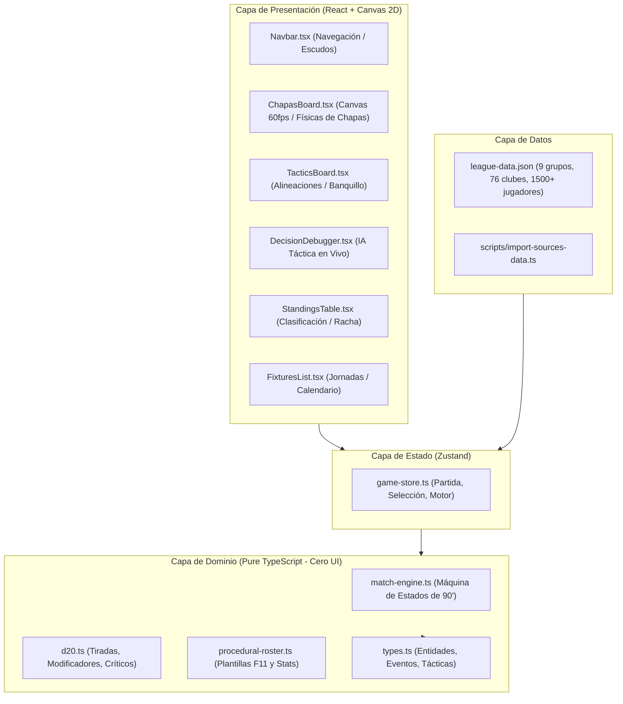
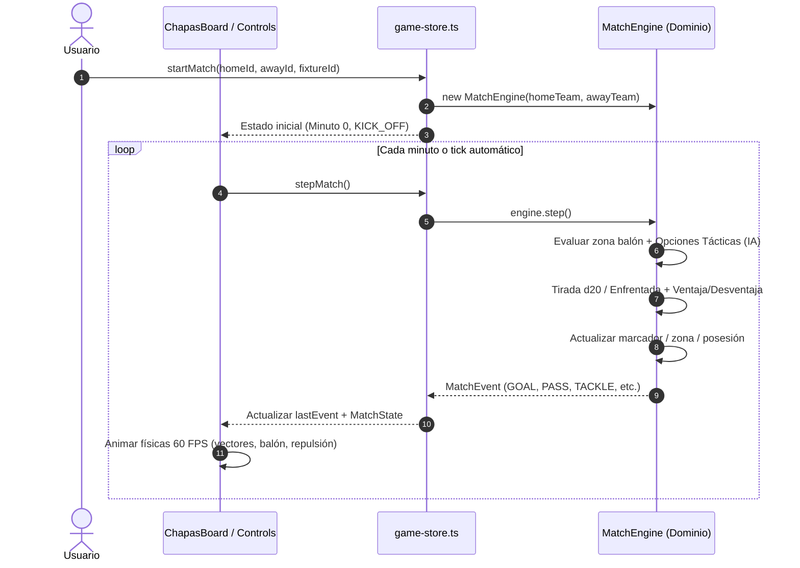

# Arquitectura del Sistema: D20 Soccer Manager (Fútbol 11)

Este documento detalla la arquitectura técnica de software del proyecto para desarrolladores y agentes de IA.

---

## 1. Visión General y Principios de Diseño

El sistema está diseñado bajo los principios de **Clean Architecture** (Arquitectura Limpia) y **Arquitectura Hexagonal (Puertos y Adaptadores)**:



### Reglas Inquebrantables de Dependencia:
1. **Dominio Autónomo (`src/domain/`)**: El código dentro de `src/domain/` es TypeScript puro. **Nunca** debe importar React, Canvas, Zustand ni librerías de UI. Puede ejecutarse idénticamente en Node.js, CLI, Web Workers o navegadores.
2. **Presentación Desacoplada (`src/presentation/`)**: Las vistas leen del store de Zustand (`src/state/game-store.ts`) o de los eventos del `MatchEngine`.
3. **Aislamiento de Fuentes (`/sources`)**: El directorio `/Users/israelvinualeslopez/sources` es **estrictamente de solo lectura**. Todo el procesamiento se realiza mediante `scripts/import-sources-data.ts` generando el fichero compilado `src/data/league-data.json`.

---

## 2. Estructura de Directorios

```
/Users/israelvinualeslopez/projects/soccer/
├── .github/workflows/
│   └── deploy.yml              # CI/CD: lint, type-check, tests, balance, build y GitHub Pages
├── docs/                       # Documentación técnica agentica
│   ├── ARCHITECTURE.md         # Este documento
│   ├── MATCH_ENGINE_D20.md     # Motor de simulación y rol d20
│   ├── CHAPAS_BOARD_AND_PHYSICS.md # Tablero 2D, físicas y Regla 8 IFAB
│   └── AGENT_GUIDE.md          # Manual de operación para agentes IA
├── scripts/
│   ├── import-sources-data.ts  # Ingesta y normalización de ligas
│   └── verify-balance.ts       # Simulación Monte Carlo (1000 partidos)
├── src/
│   ├── data/
│   │   └── league-data.json    # Base de datos precompilada
│   ├── domain/
│   │   ├── types.ts            # Tipos e interfaces de dominio
│   │   ├── d20.ts              # Reglas d20, ventajas, críticos Mulberry32
│   │   ├── d20.test.ts         # Tests unitarios del motor d20
│   │   ├── procedural-roster.ts# Generación de plantillas F11 y alineaciones
│   │   └── match-engine.ts     # Motor de partido F11 y toma de decisiones
│   ├── state/
│   │   └── game-store.ts       # Store global Zustand
│   ├── presentation/
│   │   └── components/
│   │       ├── Navbar.tsx
│   │       ├── ChapasBoard.tsx
│   │       ├── DecisionDebugger.tsx
│   │       ├── MatchAuditNavigator.tsx
│   │       ├── TeamBadge.tsx
│   │       ├── TacticsBoard.tsx
│   │       ├── StandingsTable.tsx
│   │       └── FixturesList.tsx
│   ├── App.tsx
│   ├── main.tsx
│   └── index.css
├── public/
│   └── badges/                   # Escudos locales descargados para resiliencia offline y SSL
├── package.json
├── tsconfig.json
└── vite.config.ts
```

---

## 3. Manejo de Escudos y Assets de Clubes (`TeamBadge.tsx`)

Para prevenir problemas de certificados SSL externos (como los servidores escolares IIS de ECMadrid que provocaban imágenes rotas en el navegador) o caídas de red:
1. **Descarga Local Resiliente**: Los escudos oficiales de los clubes se almacenan en `public/badges/` y son servidos localmente por Vite como recursos estáticos seguros.
2. **Componente `<TeamBadge>`**:
   - Gestiona `onError` de manera transparente.
   - En caso de fallo o ausencia de imagen, genera automáticamente un escudo heráldico con los colores característicos del equipo y sus iniciales en SVG de alta resolución, evitando iconos de imagen rota.
3. **Unificación de Selectores**: El selector de grupo está centralizado en la cabecera global (`Navbar.tsx`), eliminando selects duplicados y redundantes en el cuerpo de las vistas.

---

## 3. Flujo de Datos del Partido



---

## 4. Estrategia de Migración a Motor de Videojuego (Phaser / PixiJS / WebGL)

El diseño actual desacopla completamente la lógica matemática del renderizado:
- `MatchEngine.step()` devuelve un `MatchEvent`.
- El componente `ChapasBoard.tsx` escucha `lastEvent` y genera las trayectorias vectoriales.
- Para cambiar a **PixiJS**, **Phaser** o **Three.js**, solo se requiere crear un componente alternativo (p. ej. `PixiPitch.tsx`) que implemente el consumo de `MatchEvent`, sin tocar una sola línea de `match-engine.ts`.
