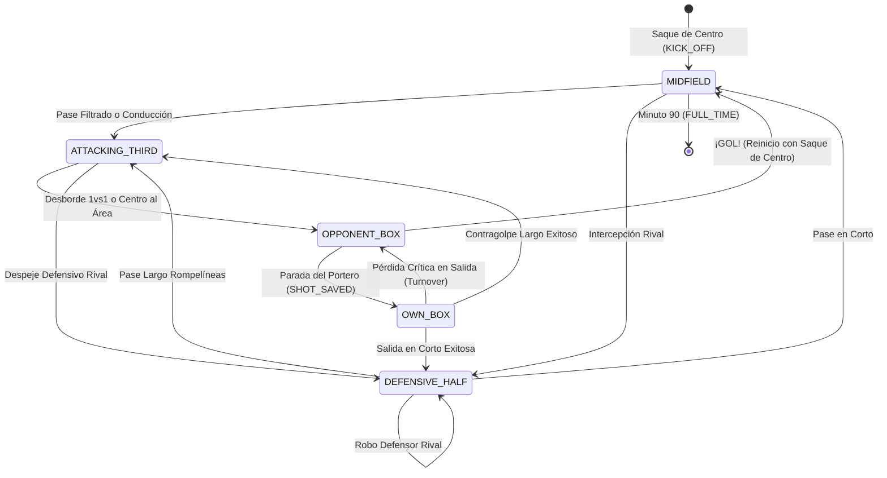

# Motor de Simulación y Sistema de Reglas D20 (`match-engine.ts`)

Este documento describe la mecánica de simulación deportiva y el sistema de reglas de rol d20 implementado en `src/domain/d20.ts` y `src/domain/match-engine.ts`.

---

## 1. Atributos D20 del Futbolista

Inspirado en el sistema clásico de rol de mesa d20, adaptado al Fútbol 11:

| Atributo | Significado en F11 | Rango Típico | Modificador Clásico d20 |
| :--- | :--- | :---: | :---: |
| **FUE (Fuerza)** | Potencia de golpeo, disparo lejano, salto en córners | 8 – 18 | `Math.floor((FUE - 10) / 2)` |
| **DES (Destreza)** | Velocidad punta, regate 1vs1, centros, reflejos de portero | 8 – 18 | `Math.floor((DES - 10) / 2)` |
| **CON (Constitución)** | Resistencia física en campo de 105m, aguante de choques | 8 – 18 | `Math.floor((CON - 10) / 2)` |
| **INT (Inteligencia)** | Visión táctica, pase filtrado, lectura de líneas de pase | 8 – 18 | `Math.floor((INT - 10) / 2)` |
| **SAB (Sabiduría)** | Posicionamiento defensivo, coberturas, anticipación | 8 – 18 | `Math.floor((SAB - 10) / 2)` |
| **CAR (Carisma)** | Liderazgo de capitán, moral del equipo bajo presión | 8 – 18 | `Math.floor((CAR - 10) / 2)` |

### Fórmula de Modificador d20:
$$\text{Modificador} = \lfloor \frac{\text{Atributo} - 10}{2} \rfloor$$
- Atributo 10 → Modificador +0
- Atributo 14 → Modificador +2
- Atributo 18 → Modificador +4

---

## 2. Resolución de Acciones y Tiradas d20

El archivo `src/domain/d20.ts` gestiona todas las operaciones estocásticas:

### 2.1. Tirada con Ventaja / Desventaja
- **Ventaja**: Se lanzan dos dados de 20 caras ($2d20$) y se escoge el **mayor**.
- **Desventaja**: Se lanzan dos dados de 20 caras ($2d20$) y se escoge el **menor**.

### 2.2. Críticos y Pifias
- **Éxito Crítico (Nat 20)**: La tirada natural del dado resulta 20 (o $\ge 18$ si el jugador tiene el rasgo `POACHER`). Supera automáticamente cualquier oposición.
- **Pifia (Nat 1)**: La tirada natural resulta 1. El pase o despeje falla de forma flagrante y genera una ocasión de peligro rival.

### 2.3. Tiradas Enfrentadas (*Contested Checks*)
Las disputas entre dos jugadores (p. ej. Delantero remata vs Portero ataja, o Extremo regatea vs Lateral tapa) se resuelven comparando:
$$\text{Total Atacante} = d20 + \text{Bono Atacante}$$
$$\text{Total Defensor} = d20 + \text{Bono Defensor}$$
El atacante vence si su resultado total supera al del defensor; en caso de empate, la ventaja de cobertura favorece a la defensa.

---

## 3. Máquina de Estados del Partido: Zonas del Terreno de Juego

El terreno de juego se divide en 5 zonas de estado secuenciales:



---

## 4. IA Táctica y Sistema de Opciones con Utilidad (`TacticalOption`)

En cada jugada, el jugador en posesión evalúa varias alternativas tácticas ponderadas:

```typescript
export interface TacticalOption {
  actionType: 'SHORT_PASS' | 'THROUGH_BALL' | 'COUNTER_ATTACK' | 'CROSS' | 'DRIBBLE' | 'LONG_SHOT' | 'BOX_FINISH';
  label: string;
  targetPlayer?: Player;
  targetZone: PitchZone;
  utilityScore: number; // 0 - 100
  riskLevel: 'LOW' | 'MEDIUM' | 'HIGH';
  reason: string;
  d20Bonus: number;
}
```

### Reglas Tácticas y de Integridad Clave:
1. **Evitar bucles al centro del campo**: Las recuperaciones defensivas en campo propio transicionan a `DEFENSIVE_HALF`, permitiendo armar juego progresivo en lugar de saltar forzadamente a `MIDFIELD`.
2. **Coherencia Táctica Posicional**:
   - Jugadores de banda (`LW`, `RW`, `LB`, `RB`): centran al área o desbordan por la línea de fondo.
   - Jugadores centrales (`CAM`, `CM`, `ST`): filtran pases al hueco entre centrales (`THROUGH_BALL`), abren a las bandas o disparan desde la frontal.
3. **Auditoría Completa de Decisiones en Goles y Paradas**: En `resolveBoxShot`, el delantero evalúa alternativas tácticas (`BOX_FINISH` a la escuadra vs `LONG_SHOT` de potencia vs `DRIBBLE` al portero) y la `decision: PlayerDecision` se asocia tanto a eventos `GOAL` como `SHOT_SAVED`.
4. **Prohibición de Auto-Pases**: La función `getActivePlayer` admite `excludePlayerIds`, garantizando que el receptor o rematador nunca sea el propio jugador que asiste.
5. **Nombres 100% Únicos por Plantilla**: El generador procedural `src/domain/procedural-roster.ts` mantiene un `Set<string>` para garantizar que ningún equipo tenga nombres o apellidos duplicados.
6. **Confinamiento de Porteros**: Las acciones de campo abierto excluyen explícitamente al portero (`excludeGK = true`). El guardameta únicamente interviene en disparos dentro del área (`OPPONENT_BOX` / `SHOT_SAVED`) y saques desde su área (`OWN_BOX`).

---

## 5. Verificación y Balance Monte Carlo

Para garantizar que el juego se comporta como Fútbol 11 realista (promedio de 2.5 a 3.8 goles por partido) sin resultados inflados, el proyecto incluye un simulador estadístico Monte Carlo:

```bash
npm run test:balance
```

**Métricas Objetivo Verificadas (1.000 partidos):**
- Promedio de goles por partido: **3.4 – 3.7 goles/partido** (típico F11 competitivo).
- Victorias Locales: **33% – 44%**.
- Empates: **18% – 26%**.
- Victorias Visitantes: **35% – 45%**.
- Tiempo de ejecución: **1.000 partidos en < 150 ms** (alta eficiencia computacional).
