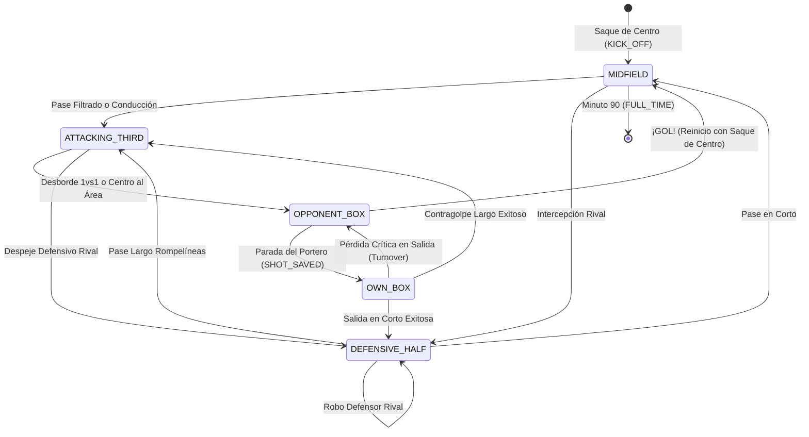

# Motor de Simulación y Sistema de Reglas D20 (`match-engine.ts`)

Este documento describe la mecánica de simulación deportiva y el sistema de reglas de rol d20 implementado en `src/domain/d20.ts` y `src/domain/match-engine.ts`.

---

## 1. Atributos D20 del Futbolista

Inspirado en el sistema clásico de rol de mesa d20, adaptado al Fútbol 11:

| Atributo | Significado en F11 | Rango Típico | Modificador Clásico d20 |
| :--- | :--- | :---: | :---: |
| **FUE (Fuerza)** | Potencia de golpeo, disparo lejano, salto en córners | 8 – 18 | `Math.floor((FUE - 10) / 2)` |
| **DES (Destreza)** | Velocidad punta, regate 1vs1, centros, reflejos de portero | 8 – 18 | `Math.floor((DES - 10) / 2)` |
| **CON (Constitución)** | Resistencia física en campo de 105m, aguante de choques | 8 – 18 | `Math.floor((CON - 10) / 2)` |
| **INT (Inteligencia)** | Visión táctica, pase filtrado, lectura de líneas de pase | 8 – 18 | `Math.floor((INT - 10) / 2)` |
| **SAB (Sabiduría)** | Posicionamiento defensivo, coberturas, anticipación | 8 – 18 | `Math.floor((SAB - 10) / 2)` |
| **CAR (Carisma)** | Liderazgo de capitán, moral del equipo bajo presión | 8 – 18 | `Math.floor((CAR - 10) / 2)` |

### Fórmula de Modificador d20:
$$\text{Modificador} = \lfloor \frac{\text{Atributo} - 10}{2} \rfloor$$
- Atributo 10 → Modificador +0
- Atributo 14 → Modificador +2
- Atributo 18 → Modificador +4

---

## 2. Resolución de Acciones y Tiradas d20

El archivo `src/domain/d20.ts` gestiona todas las operaciones estocásticas:

### 2.1. Tirada con Ventaja / Desventaja
- **Ventaja**: Se lanzan dos dados de 20 caras ($2d20$) y se escoge el **mayor**.
- **Desventaja**: Se lanzan dos dados de 20 caras ($2d20$) y se escoge el **menor**.

### 2.2. Críticos y Pifias
- **Éxito Crítico (Nat 20)**: La tirada natural del dado resulta 20 (o $\ge 18$ si el jugador tiene el rasgo `POACHER`). Supera automáticamente cualquier oposición.
- **Pifia (Nat 1)**: La tirada natural resulta 1. El pase o despeje falla de forma flagrante y genera una ocasión de peligro rival.

### 2.3. Tiradas Enfrentadas (*Contested Checks*)
Las disputas entre dos jugadores (p. ej. Delantero remata vs Portero ataja, o Extremo regatea vs Lateral tapa) se resuelven comparando:
$$\text{Total Atacante} = d20 + \text{Bono Atacante}$$
$$\text{Total Defensor} = d20 + \text{Bono Defensor}$$
El atacante vence si su resultado total supera al del defensor; en caso de empate, la ventaja de cobertura favorece a la defensa.

---

## 3. Máquina de Estados del Partido: Zonas del Terreno de Juego

El terreno de juego se divide en 5 zonas de estado secuenciales:



---

## 4. IA Táctica y Sistema de Opciones con Utilidad (`TacticalOption`)

En cada jugada, el jugador en posesión evalúa varias alternativas tácticas ponderadas:

```typescript
export interface TacticalOption {
  actionType: 'SHORT_PASS' | 'THROUGH_BALL' | 'COUNTER_ATTACK' | 'CROSS' | 'DRIBBLE' | 'LONG_SHOT' | 'BOX_FINISH';
  label: string;
  targetPlayer?: Player;
  targetZone: PitchZone;
  utilityScore: number; // 0 - 100
  riskLevel: 'LOW' | 'MEDIUM' | 'HIGH';
  reason: string;
  d20Bonus: number;
}
```

### Reglas Tácticas y de Integridad Clave:
1. **Evitar bucles al centro del campo**: Las recuperaciones defensivas en campo propio transicionan a `DEFENSIVE_HALF`, permitiendo armar juego progresivo en lugar de saltar forzadamente a `MIDFIELD`.
2. **Coherencia Táctica Posicional**:
   - Jugadores de banda (`LW`, `RW`, `LB`, `RB`): centran al área o desbordan por la línea de fondo.
   - Jugadores centrales (`CAM`, `CM`, `ST`): filtran pases al hueco entre centrales (`THROUGH_BALL`), abren a las bandas o disparan desde la frontal.
3. **Auditoría Completa de Decisiones en Goles y Paradas**: En `resolveBoxShot`, el delantero evalúa alternativas tácticas (`BOX_FINISH` a la escuadra vs `LONG_SHOT` de potencia vs `DRIBBLE` al portero) y la `decision: PlayerDecision` se asocia tanto a eventos `GOAL` como `SHOT_SAVED`.
4. **Prohibición de Auto-Pases**: La función `getActivePlayer` admite `excludePlayerIds`, garantizando que el receptor o rematador nunca sea el propio jugador que asiste.
5. **Nombres 100% Únicos por Plantilla**: El generador procedural `src/domain/procedural-roster.ts` mantiene un `Set<string>` para garantizar que ningún equipo tenga nombres o apellidos duplicados.
6. **Confinamiento de Porteros**: Las acciones de campo abierto excluyen explícitamente al portero (`excludeGK = true`). El guardameta únicamente interviene en disparos dentro del área (`OPPONENT_BOX` / `SHOT_SAVED`) y saques desde su área (`OWN_BOX`).

---

## 5. Arquetipos Conductuales de Personalidad (`PlayerPersonalityType`)

Cada jugador cuenta con un arquetipo de personalidad persistente que modula sus decisiones independientemente de la posición en la que el entrenador lo alinee:

| Arquetipo | Icono | Descripción Conductual | Modulación de Utilidad en IA |
| :--- | :---: | :--- | :--- |
| `SOLO_DRIBBLER` | ⚡ | **Regateador Nato**: Encarador individualista; busca desbordar 1vs1 o avanzar en conducción aun colocado en el pivote. | $+26$ a `DRIBBLE` y `CONTROL_AND_DRIVE`; $-14$ a pases conservadores. |
| `PASS_MAESTRO` | 🎯 | **Maestro del Pase**: Distribuidor altruista; busca abrir juego a banda contraria o filtrar balones en diagonal. | $+26$ a `THROUGH_BALL`, `SWITCH_PLAY` y `SHORT_PASS`; $-16$ a conducciones solitarias. |
| `SNIPER_SHOOTER` | 🚀 | **Francotirador**: Gatillo fácil; busca el disparo inmediato a puerta al pisar tres cuartos o frontal del área. | $+28$ a `LONG_SHOT` y `BOX_FINISH`; $-14$ a temporizar la jugada. |
| `BOX_TO_BOX_RUNNER` | 🏃 | **Box-to-Box**: Pulmón incansable; ataca canales profundos mediante sprints verticales al espacio y dobla carriles. | $+26$ a `CHANNEL_SPRINT` e incorporaciones al área rival; $+12$ a repliegues. |
| `SAFETY_FIRST` | 🛡️ | **Conservador Táctico**: Prioriza no perder la posesión; apoya en corto o retrasa la jugada al central/pivote. | $+28$ a `SAFETY_BACKPASS` y `HOLD_UP_PLAY`; $-20$ a desbordes de alto riesgo. |
| `AGGRESSIVE_PRESSER` | ⚔️ | **Presión Feroz**: Recuperador voraz; muerde líneas de pase, encisma al receptor y fuerza pérdidas rivales. | $+20$ en disputas divididas; $+2$ de bonificación en tiradas defensivas. |

La función pura `applyPersonalityBias(player: Player, opt: TacticalOption): TacticalOption` ajusta el índice de utilidad de cada opción analizada antes de la toma de decisiones.

---

## 6. Sistema de Micro-Ticks (20–30s por Acción) y Micro-Acciones Tácticas

Para simular el ritmo real de un partido sin saltar abruptamente de un tiro a otro, el motor subdivide el encuentro en **180 micro-ticks** (~30 segundos cada uno):

- **Tick Impar**: Segundo 00 (`min' 00"`).
- **Tick Par**: Segundo 30 (`min' 30"`).

### Nuevas Micro-Acciones Tácticas:
1. `CONTROL_AND_DRIVE`: El jugador amortigua la pelota, fija al rival y avanza unos 4-5 metros con balón dominado mientras sus compañeros se perfilan.
2. `CHANNEL_SPRINT`: Desmarque de ruptura vertical al espacio hacia la esquina o banderín de córner, obligando al lateral rival a una carrera de persecución.
3. `SWITCH_PLAY`: Cambio de orientación con golpeo largo diagonal hacia el extremo o lateral de la banda contraria libre de marca.
4. `HOLD_UP_PLAY`: Delantero o mediapunta aguanta el balón de espaldas protegiéndolo con el cuerpo hasta la llegada de apoyos desde segunda línea.
5. `SAFETY_BACKPASS`: Pase de seguridad en corto retrasado a la defensa o pivote para reiniciar la circulación limpia.

---

## 7. Gestión de Esfuerzo, Sprints y Fatiga (`applyEffort`)

Cada acción del partido computa un consumo de energía diferenciado según su intensidad:

| Nivel de Esfuerzo | Acciones Típicas | Desgaste Base de Stamina | Modulador de Constitución (`CON`) |
| :--- | :--- | :---: | :---: |
| **`LOW`** | Pase de seguridad, temporización, apoyo en corto | $-0.5\%$ a $-0.9\%$ | Mayor CON amortigua hasta $-0.4\%$ |
| **`MEDIUM`** | Conducción sostenida, circulación fluida | $-1.3\%$ a $-1.8\%$ | Reducción de hasta un $30\%$ de gasto |
| **`HIGH`** (Sprint) | Ruptura al canal (`CHANNEL_SPRINT`), regate explosivo 1vs1, repliegue desesperado | $-2.6\%$ a $-3.5\%$ | Jugadores con CON 16+ ahorran energía crítica |

### Consecuencias de la Fatiga:
- **Descanso (Tick 90 / Min 45)**: Los jugadores recuperan $+20\%$ a $+25\%$ de stamina en el vestuario (modulado por CON).
- **Penalizaciones D20 por Agotamiento**:
  - $\text{Stamina} < 30\%$: Modificador $-1$ en todas las tiradas de dados por cansancio muscular.
  - $\text{Stamina} < 15\%$: Modificador $-2$ en todas las tiradas y riesgo elevado de perder duelos directos.

---

## 8. Verificación y Balance Monte Carlo

Para garantizar que el juego se comporta como Fútbol 11 realista (promedio de 2.5 a 4.0 goles por partido) a pesar de duplicar la cantidad de eventos con micro-ticks de 30s, el proyecto incluye un simulador estadístico Monte Carlo:

```bash
npm run test:balance
```

**Métricas Objetivo Verificadas (1.000 partidos simulados):**
- Promedio de goles por partido: **3.8 – 4.0 goles/partido** (ventana reglamentaria [1.8, 4.2]).
- Victorias Locales: **29% – 36%**.
- Empates: **20% – 26%**.
- Victorias Visitantes: **42% – 49%**.
- Rendimiento: **1.000 partidos en ~320 ms (> 3.000 partidos/seg)** en TypeScript puro sin memory leaks.
